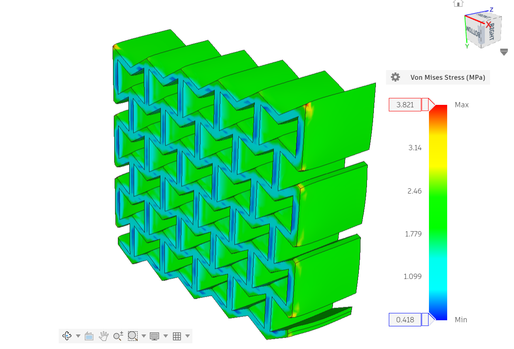
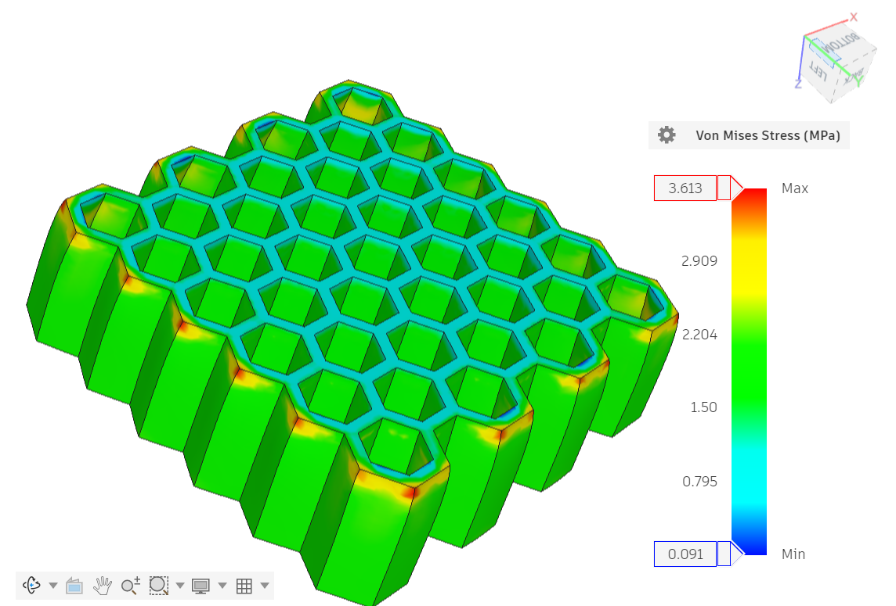
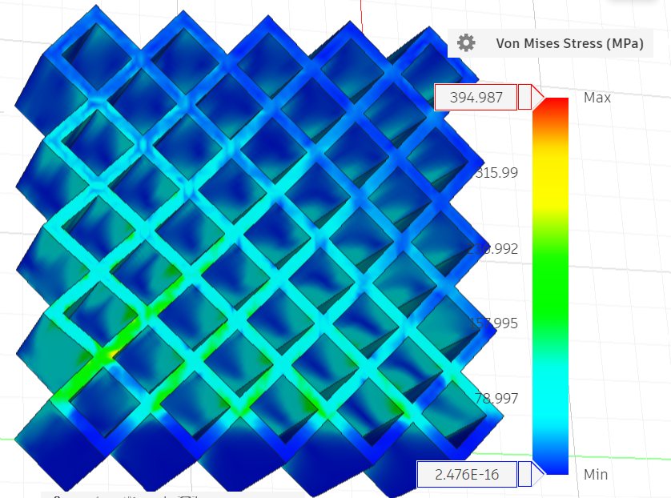
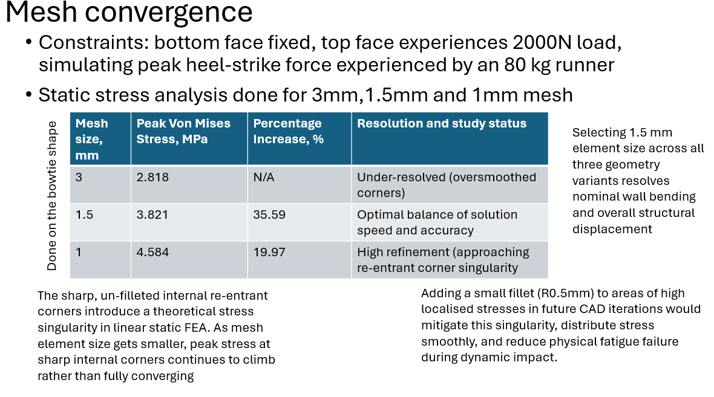
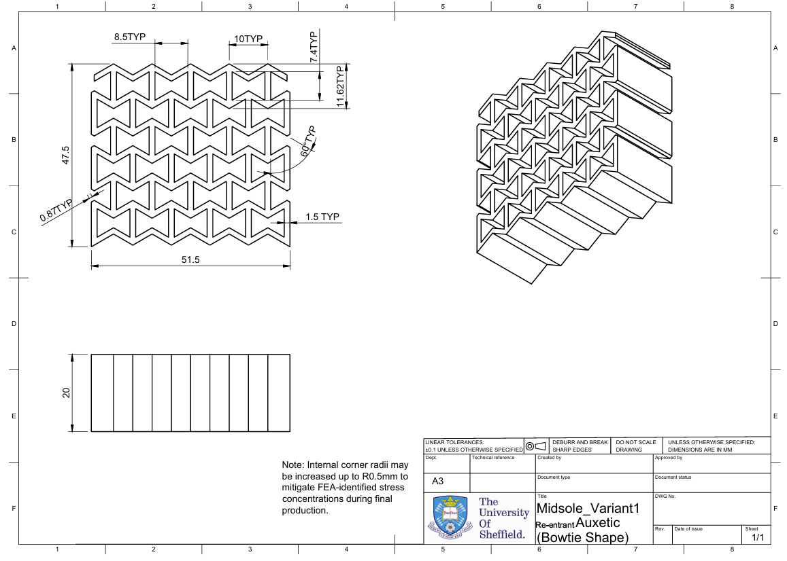
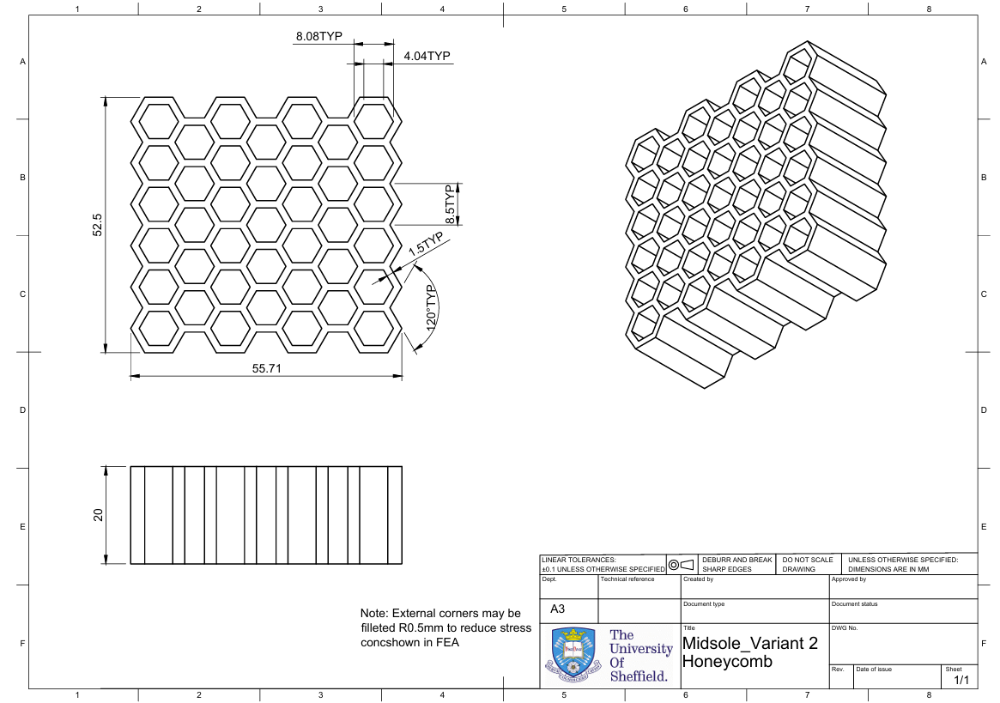
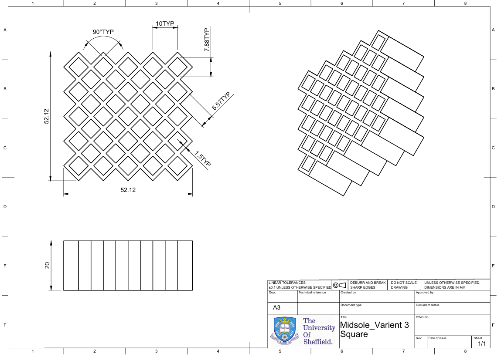

# Midsole Lattice Optimization: FEA & DfAM Study


## Project Overview
This repository details a finite element analysis (FEA) and Design for Additive Manufacturing (DfAM) study comparing three thermoplastic polyurethane (TPU) midsole lattice geometries: **Re-entrant Auxetic**, **Hexagonal Honeycomb**, and **Diamond Grid**[cite: 1]. 

Under a simulated **$2,000\text{ N}$ peak heel-strike load** (80 kg runner baseline), geometries were benchmarked for Specific Energy Absorption (SEA), effective structural stiffness, mass reduction, and mechanical stress distribution[cite: 1].
> 📊 **Executive Resources**: View the slide deck [Project Presentation Deck (PPTX)](docs/Midsole%20analysis.pptx) or download the [1-Page Executive Summary (PDF)](docs/Midsole%20Lattice%20Optimisation%20summary%20.pdf).
---

## Executive Summary & Performance Matrix

| Re-entrant Auxetic Stress | Hexagonal Honeycomb Stress | Diamond Grid Stress |
| :---: | :---: | :---: |
|  |  |  |

| Metric | Solid Baseline | Re-entrant Auxetic | Hexagonal Honeycomb | Diamond Grid |
| :--- | :--- | :--- | :--- | :--- |
| **Bounding Dimensions (mm)** | $50 \times 50 \times 20$ | $47.5 \times 51.5 \times 20$ | $55.7 \times 52.5 \times 20$ | $52.1 \times 52.1 \times 20$ |
| **Equivalent TPU Mass (g)** | $60.00$ | $23.97$ | $23.31$ | $23.30$ |
| **Mass Savings vs. Baseline (%)** | $0.0\%$ | $60.1\%$ | **$61.2\%$** | **$61.2\%$** |
| **Relative Density ($\rho/\rho_s$)** | $1.000$ | $0.388$ | $0.388$ | $0.357$ |
| **Peak von Mises Stress (MPa)** | — | $3.821$ | **$3.613$** | $4.447$ |
| **Max Displacement ($\Delta y$, mm)** | — | $-1.412$ | $-1.473$ | $-1.458$ |
| **Effective Stiffness ($K$, N/mm)** | — | **$1,416.43$** | $1,357.77$ | $1,371.74$ |
| **Specific Energy Absorption (J/kg)**| — | $58.91$ | **$63.19$** | $62.58$ |

*All variants evaluated at a validated 1.5 mm element mesh baseline*

---

## Key Engineering Takeaways
* **Highest Specific Energy Absorption (SEA)**: **Hexagonal Honeycomb** achieved $63.19\text{ J/kg}$, providing maximum energy damping for heel impact cushion zones.
* **Maximum Structural Stiffness**: **Re-entrant Auxetic** delivered $1,416.43\text{ N/mm}$ stiffness (lowest compliance), making it ideal for stability-critical zones.
* **Mass Optimization**: All three lattice topologies achieved >60% mass reduction relative to a solid TPU control block.
* **Stress Concentrations**: The Diamond Grid exhibited the highest peak stress ($4.447\text{ MPa}$), whereas Honeycomb produced lower stress concentrations across bottom fixed boundary constraints.

---

## Mesh Sensitivity & Convergence Study



Static stress analysis was executed across $3.0\text{ mm}$, $1.5\text{ mm}$, and $1.0\text{ mm}$ element sizes on the Re-entrant Auxetic structure.

| Mesh Size (mm) | Peak Von Mises Stress (MPa) | % Change | Study Status |
| :--- | :--- | :--- | :--- |
| **3.0** | 2.818 | Baseline | Under-resolved (oversmoothed corners) |
| **1.5** | 3.821 | +35.6% | **Optimal Target Mesh (Selected)** |
| **1.0** | 4.584 | +19.97% | High Refinement (Corner Singularity) |

*Note: Un-filleted internal re-entrant corners introduce a theoretical stress singularity in linear static FEA. Adding R = 0.5 mm fillets in future CAD iterations will eliminate localized stress spikes and improve fatigue life.*

---

## Design for Additive Manufacturing (DfAM)

* **Supportless Printing**: Vertical $90^\circ$ wall alignment eliminates overhangs and removes the need for internal support structures.
* **Toolpath Optimisation**: Uniform $1.5\text{ mm}$ wall thickness maps directly to 3–4 continuous perimeter passes on a standard $0.4\text{ mm}$ FDM nozzle.
* **Slicing Validation (Kiri:Moto Slicer)**:
  * **Re-entrant Auxetic**: $04\text{h }45\text{m }18\text{s}$ print time ($26.05\text{ g}$ TPU)
  * **Hexagonal Honeycomb**: $05\text{h }00\text{m }26\text{s}$ print time ($25.73\text{ g}$ TPU)
  * **Diamond Grid**: $04\text{h }49\text{m }22\text{s}$ print time ($25.75\text{ g}$ TPU)

---

## Technical Drawings & CAD Documentation

Click any drawing below to view the full PDF specification in `docs/`:

| Re-entrant Auxetic Drawing | Hexagonal Honeycomb Drawing | Diamond Grid Drawing |
| :---: | :---: | :---: |
| [](docs/Engineering_Drawing_Reentrant.pdf) | [](docs/Engineering_Drawing_Honeycomb.pdf) | [](docs/Engineering_Drawing_Diamond.pdf) |

## Technical Formulations
* **Effective Stiffness**: $K = \frac{F}{\vert{}\Delta y\vert{}} \quad [\text{N/mm}]$
* **Strain Energy**: $U = \frac{1}{2} F \vert{}\Delta y\vert{} \quad [\text{mJ}]$
* **Specific Energy Absorption**: $\text{SEA} = \frac{U_{\text{Joules}}}{m_{\text{kg}}} \quad [\text{J/kg}]$

---

## Repository Contents
```text
footwear-auxetic-midsole-fea/
├── assets/
│   ├── CAD_Variant1_Reentrant_Iso.png
│   ├── CAD_Variant1_Reentrant_Top.png
│   ├── CAD_Variant2_Honeycomb_Iso.png
│   ├── CAD_Variant2_Honeycomb_Top.png
│   ├── CAD_Variant3_DiamondGrid_Iso.png
│   ├── CAD_Variant3_DiamondGrid_Top.png
│   ├── Drawing_Sheet_Diamond.png
│   ├── Drawing_Sheet_Honeycomb.png
│   ├── Drawing_Sheet_Reentrant.png
│   ├── FEA_Mesh_Convergence_Slide.png
│   ├── FEA_Variant1_Reentrant_Displacement.png
│   ├── FEA_Variant1_Reentrant_Stress.png
│   ├── FEA_Variant2_Honeycomb_Displacement.png
│   ├── FEA_Variant2_Honeycomb_Stress.png
│   ├── FEA_Variant3_DiamondGrid_Displacement.png
│   ├── FEA_Variant3_DiamondGrid_Stress.png
│   └── hero banner.png
├── cad_files/
│   ├── Reentrant auxetic.3mf
│   ├── honeycomb.3mf
│   └── square .3mf
├── docs/
│   ├── Engineering_Drawing_Diamond.pdf
│   ├── Engineering_Drawing_Honeycomb.pdf
│   ├── Engineering_Drawing_Reentrant.pdf
│   ├── Midsole Lattice Optimisation summary .pdf
│   └── Midsole analysis.pptx
└── README.md
